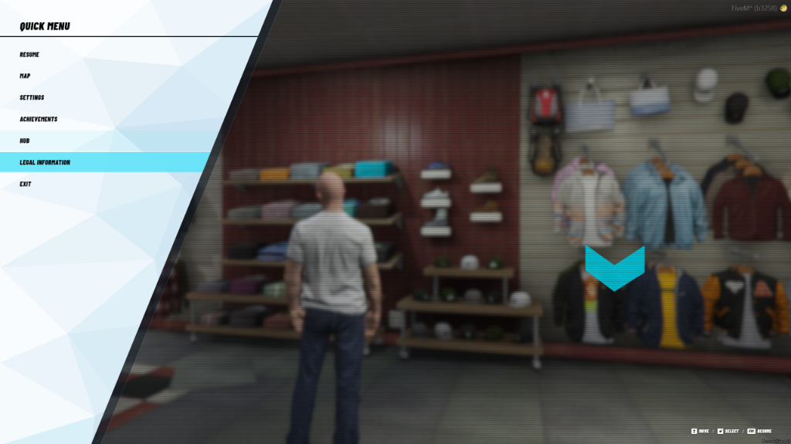
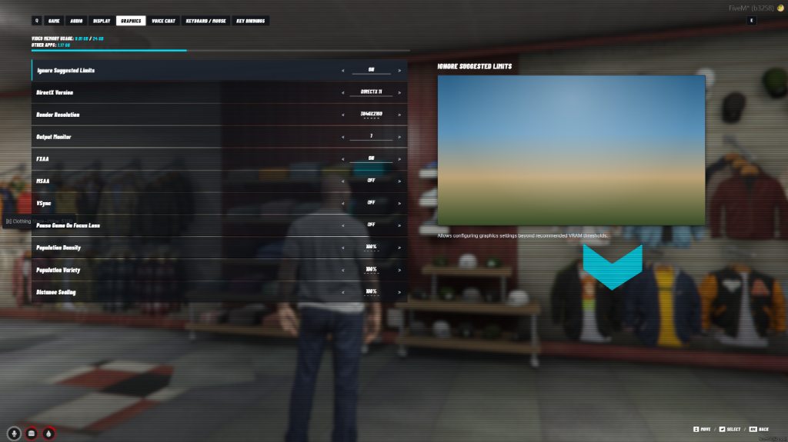
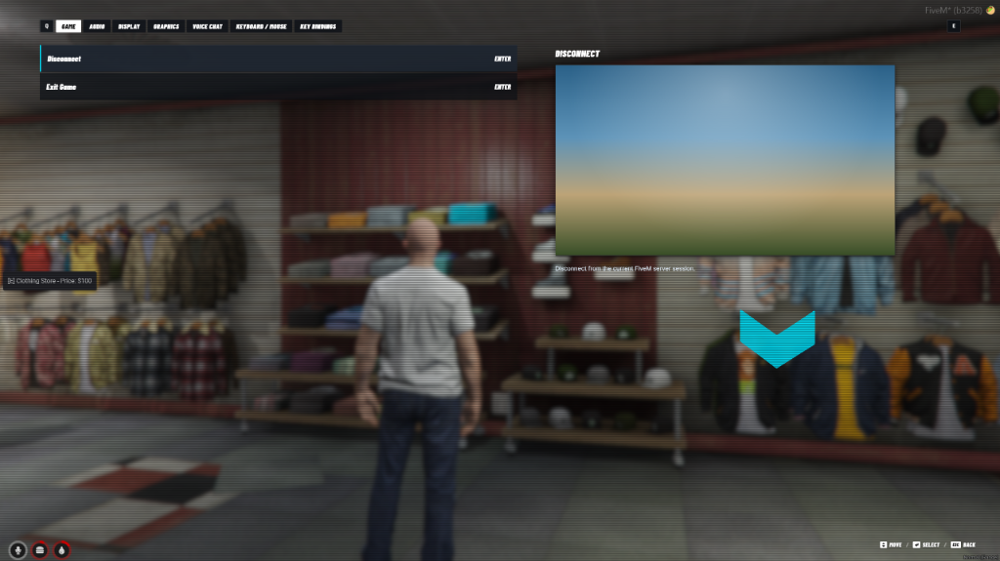

# np-quickmenu

NoPixel 5.0 inspired Quick Menu & Pause Replacement for FiveM.

---

## Project Status

**Work in Progress (~90% Complete)**  
This resource is actively being developed and polished. Most core navigation features, settings menus, and persistence systems are fully operational. Additional integrations and UI refinements are ongoing.

---

## Previews

### Quick Menu (Main View)


### Graphics Settings


### Game Settings & Disconnect


---

## Features

- **NoPixel 4.0 Aesthetic**: 1:1 replica of the geometric vector left side panel, cyan highlights, and clean typography.
- **Pause Replacement**: Seamlessly intercepts the default GTA V pause screen (ESC key) with zero lag.
- **Main Menu Navigation**:
  - **Resume**: Closes the menu and returns to gameplay.
  - **Map**: Opens the GTA V radar map screen.
  - **Settings**: Navigates to in-depth customizable settings.
  - **Achievements**: Server achievement overview.
  - **Hub**: Quick link or portal to server dashboard / stats.
  - **Legal Information**: Server rules and notices.
  - **Exit**: Disconnect or exit prompt.
- **Comprehensive Settings**:
  - **Game**: Radar, HUD visibility, measurement systems (Metric/Imperial), GPS routes.
  - **Audio**: SFX, music volume, audio output device, mute on focus loss.
  - **Display**: Brightness, safezone sizing, weapon target reticle settings.
  - **Graphics**: DirectX version, render resolution, FXAA, MSAA, VSync, texture and shader quality presets.
  - **Voice Chat**: Voice mode, microphone input, sensitivity, and volume levels.
  - **Keyboard / Mouse**: Mouse input type, sensitivity, inversion options.
  - **Key Bindings**: Quick reference for custom server hotkeys.
- **Persistent Storage**: Utilizes FiveM client KVP (`SetResourceKvp` / `GetResourceKvpString`) to automatically save and restore user preferences between sessions.
- **Resolution Scaling**: Built with responsive viewport units (`vw`/`vh`) to ensure crisp rendering on 1080p, 1440p, and 4K UHD monitors.
- **Standalone Compatibility**: Works out of the box on Qbox, QBCore, ESX, or standalone FiveM servers.

---

## Installation

1. Clone or download this repository.
2. Place the `np-quickmenu` folder into your FiveM server's `resources` directory (e.g. `resources/[standalone]/np-quickmenu`).
3. Add the following line to your `server.cfg`:
   ```cfg
   ensure np-quickmenu
   ```
4. Start or restart your server.

---

## Controls

| Key | Action |
| --- | --- |
| ESC | Open / Close Quick Menu |
| ARROW UP / ARROW DOWN | Navigate list items |
| ARROW LEFT / ARROW RIGHT | Adjust setting value |
| ENTER | Select item |
| BACKSPACE / ESC | Return to previous menu / Exit |
| Q / E | Switch settings tabs |

---

## Roadmap / Remaining Tasks

- [ ] Complete sub-menu integration for external web dashboards (Hub link).
- [ ] Add direct keybind remapping integration for custom server controls.
- [ ] Implement live preview widgets for camera/display adjustments.
- [ ] Add localization support (multi-language string dictionaries).

---

## Credits

- Design inspired by NoPixel 4.0.
- Developed for FiveM community.
